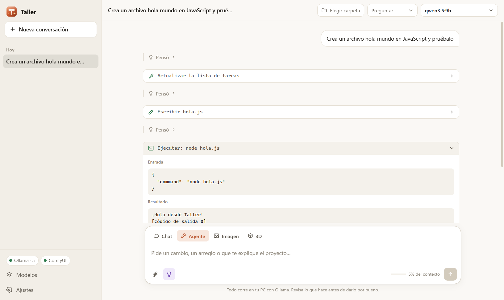
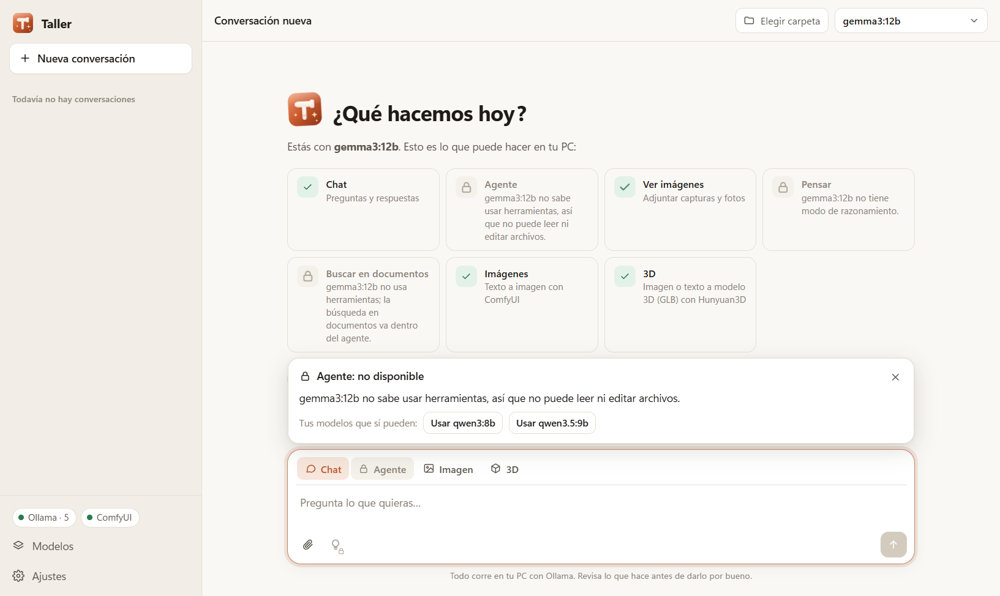
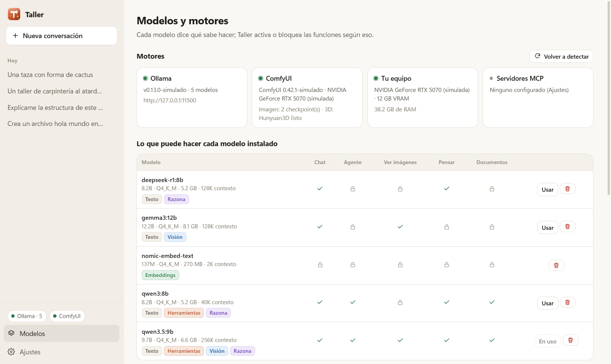
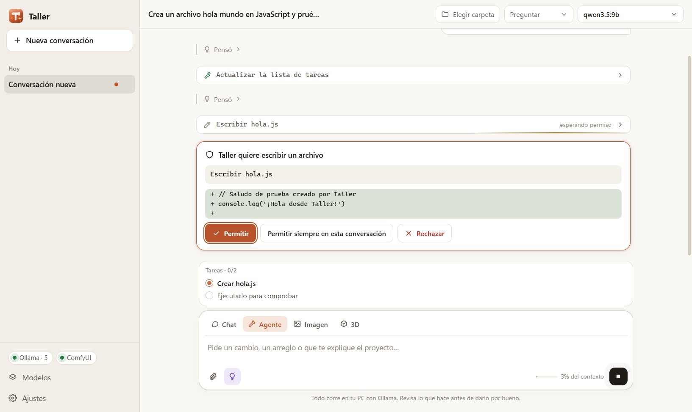
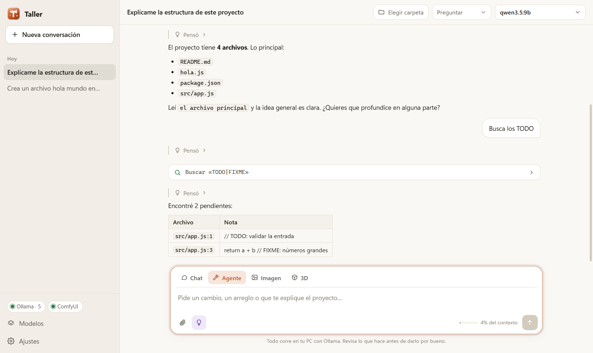
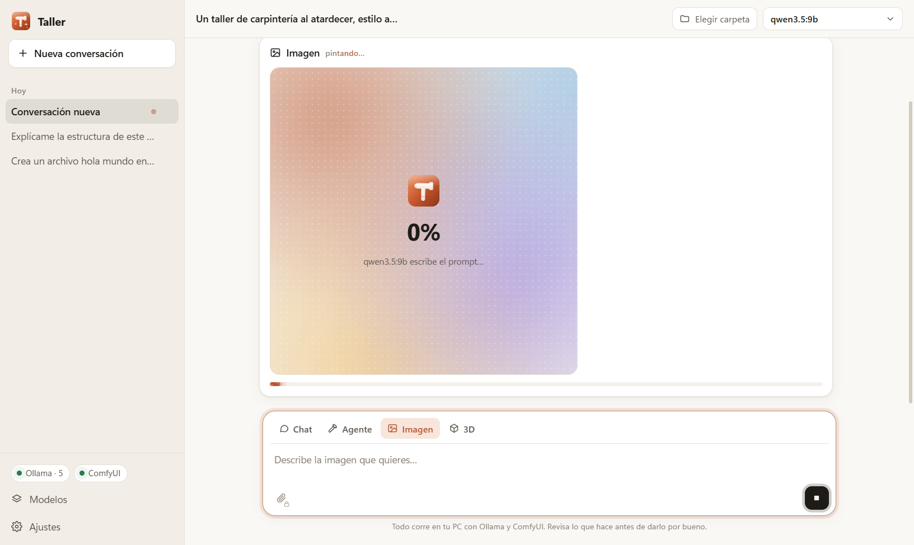
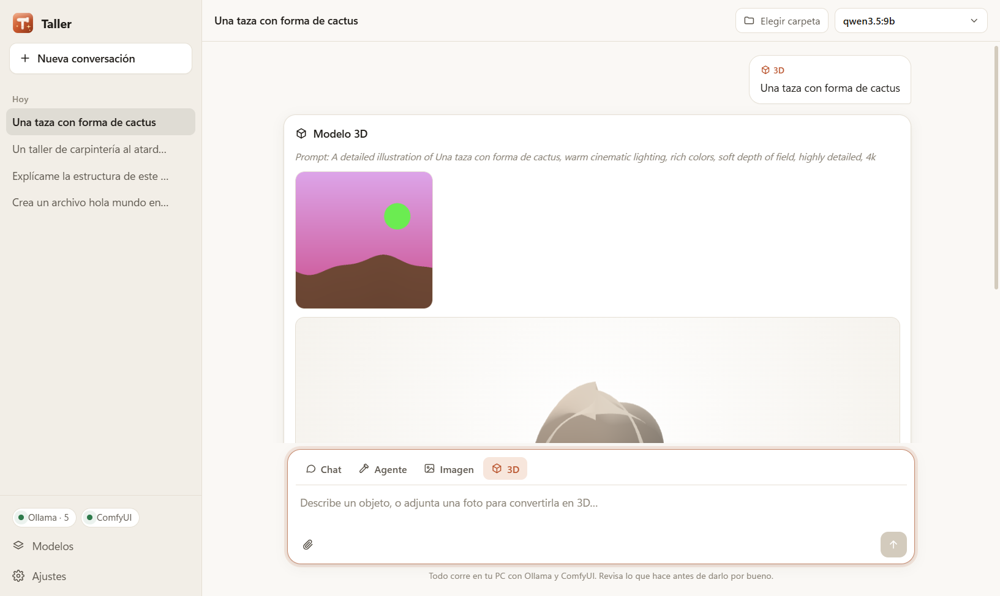

<p align="center">
  
</p>

<h1 align="center">Taller</h1>

<p align="center">
  Un agente de IA que corre en <b>tu</b> PC: conversa, programa en tus carpetas, dibuja imágenes y crea modelos 3D,<br>
  con el modelo que tengas en Ollama. Cada modelo dice qué sabe hacer y Taller activa o bloquea las funciones según eso.
</p>

<p align="center">
  
</p>

## Qué hace

| Modo | Qué hace | Qué necesita |
|---|---|---|
| **Chat** | Preguntas y respuestas con Markdown, tablas y código | Cualquier modelo de texto |
| **Agente** | Lee y edita archivos, busca, corre comandos, lleva una lista de tareas, lanza subagentes y usa herramientas MCP | Un modelo con **Herramientas** |
| **Imagen** | Texto a imagen; el modelo de chat reescribe tu idea como prompt en inglés | ComfyUI con un checkpoint (SDXL, Flux…) |
| **3D** | Foto o texto a modelo 3D (GLB) que puedes girar en la app | ComfyUI con Hunyuan3D 2.x |

Además se puede **adjuntar imágenes** (si el modelo tiene **Visión**), activar **Pensar** (si **Razona**) y **buscar por significado** en la carpeta (con un modelo de embeddings).

### Cada modelo dice qué puede hacer

Taller le pregunta a Ollama las capacidades de cada modelo (`/api/show` → `capabilities`), sin listas escritas a mano. Lo que el modelo no puede hacer aparece con candado; al tocarlo, Taller explica por qué y ofrece los modelos instalados que sí pueden, o uno para descargar.

<p align="center">
  
  
</p>

## Empezar

1. Instala **Ollama**: <https://ollama.com/download>.
2. Instala Taller desde este repo:
   ```bash
   npm install
   npm run dev
   ```
3. Taller detecta Ollama solo (lo busca cada 5 segundos mientras no lo encuentra). Si está instalado pero apagado, tiene un botón para abrirlo. Si no hay modelos, recomienda los que le caben a tu GPU y los descarga con barra de progreso.

Para generar un instalador de Windows: `npm run dist` (queda en `release/`).

### Imágenes y 3D (opcional)

Necesitas [ComfyUI](https://github.com/Comfy-Org/ComfyUI) corriendo (portable: puerto 8188; Desktop: 8000):

- **Imagen:** cualquier checkpoint de un archivo en `ComfyUI/models/checkpoints` (por ejemplo `sd_xl_base_1.0.safetensors`).
- **3D:** `hunyuan_3d_v2.1.safetensors` ([Hugging Face](https://huggingface.co/Comfy-Org/hunyuan3D_2.1_repackaged)), unos 10 GB de VRAM. El flujo es el mismo de Plasmo: imagen → Hunyuan3D → GLB.

## Modelos recomendados

| Modelo | Para qué | Capacidades |
|---|---|---|
| `qwen3.5:9b` | Todo terreno | Herramientas · Visión · Razona |
| `qwen3:8b` / `qwen3:14b` | Agente de código | Herramientas · Razona |
| `qwen3-vl:8b` | Capturas y documentos | Herramientas · Visión · Razona |
| `qwen3-coder:30b` | El mejor para programar (GPU + RAM) | Herramientas |
| `gemma3:12b` | Conversa y ve imágenes | Visión (sin herramientas) |
| `llama3.2:3b` | PCs sin GPU | Herramientas |
| `nomic-embed-text` | Activa «Buscar en documentos» | Embeddings |

Puedes descargar cualquier otro de la [biblioteca de Ollama](https://ollama.com/library) desde la vista **Modelos**.

## El agente

Herramientas: `read_file`, `write_file`, `edit_file` (reemplazo exacto y único), `list_files`, `grep`, `run_command` (PowerShell en Windows), `web_fetch`, `todo_write`, `task` (subagente de solo lectura), `semantic_search`, `generate_image`, `generate_3d` y las de tus servidores MCP.

| Permisos | Qué pregunta |
|---|---|
| **Preguntar** | Antes de editar archivos, ejecutar comandos, entrar a la web o usar MCP |
| **Auto-editar** | Edita archivos de la carpeta sin preguntar; los comandos sí preguntan |
| **Todo permitido** | Nada (úsalo en carpetas de prueba) |
| **Solo plan** | El agente solo mira y propone un plan |

<p align="center">
  
  
</p>

- **Memoria del proyecto:** si la carpeta tiene `TALLER.md` (o `AGENTS.md`, o `CLAUDE.md`), sus instrucciones entran al agente.
- **Contexto:** cuando la conversación llena el 80 % de la ventana, Taller la resume sola y sigue.
- **Modelos que escriben la llamada como texto:** Taller rescata `<tool_call>{…}</tool_call>` y bloques JSON, algo común en modelos locales.

### Servidores MCP

En **Ajustes → Servidores MCP**, con el mismo formato de `.mcp.json` (también se puede importar el de la carpeta). Por ejemplo, [REA](https://github.com/morluto/rea) para ingeniería inversa:

```json
{
  "rea": { "command": "npx", "args": ["-y", "rea-agents@6.7.0", "mcp"] }
}
```

## Imágenes y 3D

<p align="center">
  
  
</p>

## Probar sin GPU

Hay simuladores de Ollama y ComfyUI con las mismas rutas y formatos que los reales:

```bash
npm run simular
```

Luego `npm run dev` en otra terminal. `npm run simular -- --vacio` arranca Ollama sin modelos, para ver la bienvenida. `npm run capturas` recorre la app con Playwright y regenera las imágenes de `capturas/`.

```bash
npm test
npm run typecheck
```

## Cómo está hecho

Electron + React + TypeScript, con [electron-vite](https://electron-vite.org).

```
src/
  main/         proceso principal: Ollama, ComfyUI, MCP, sesiones y el agente
    agente/     bucle, herramientas, permisos, prompt de sistema y compactación
  preload/      puente seguro (window.taller)
  renderer/     la interfaz
  shared/       tipos, la matriz de funciones por modelo y el catálogo
scripts/        simuladores, capturas e ícono
tests/          pruebas con Vitest
```

El comportamiento del agente (herramientas, permisos, subagentes, MCP, compactación, archivo de memoria) sigue la documentación pública de Claude Code y agentes abiertos como [Qwen Code](https://github.com/QwenLM/qwen-code) y [OpenCode](https://github.com/sst/opencode). No usa código de Claude Code.

## Lo que falta probar

- Todo se probó con los simuladores; falta una pasada con Ollama y ComfyUI reales en una GPU.
- Un modelo local de 8–14B no rinde como un modelo grande en la nube: va bien para tareas acotadas.
- Probado en Windows 11. macOS y Linux deberían funcionar, pero no se han probado.
- El instalador no está firmado: Windows SmartScreen avisará la primera vez.

## Licencia

MIT © 2026 Randy Grullón
