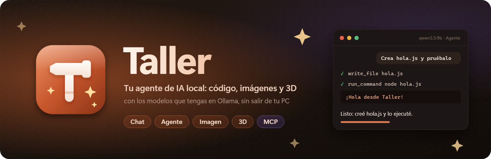
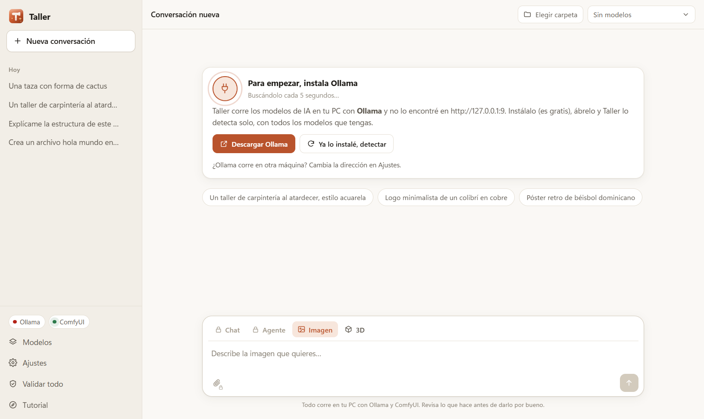
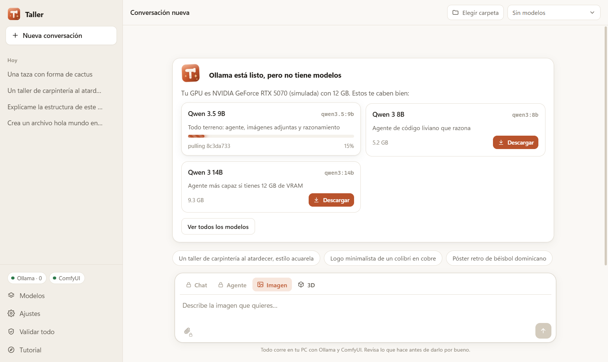
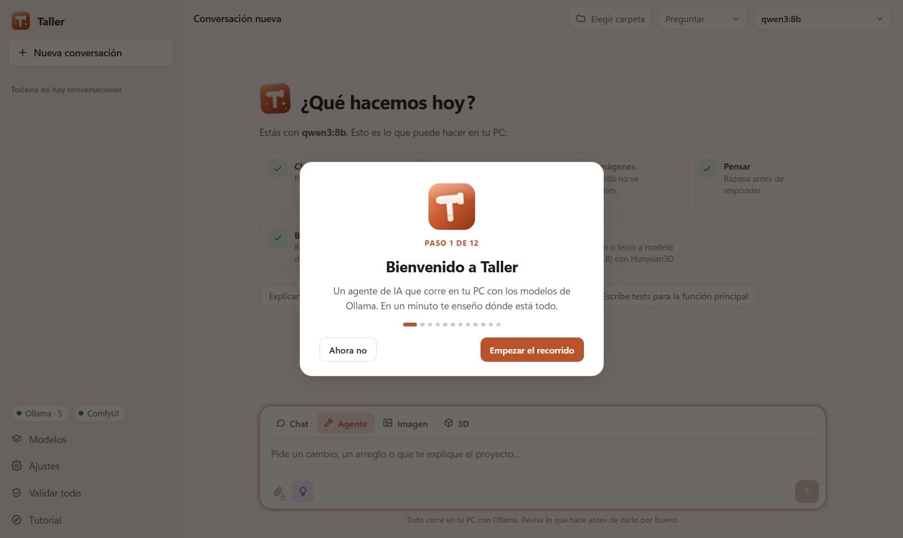
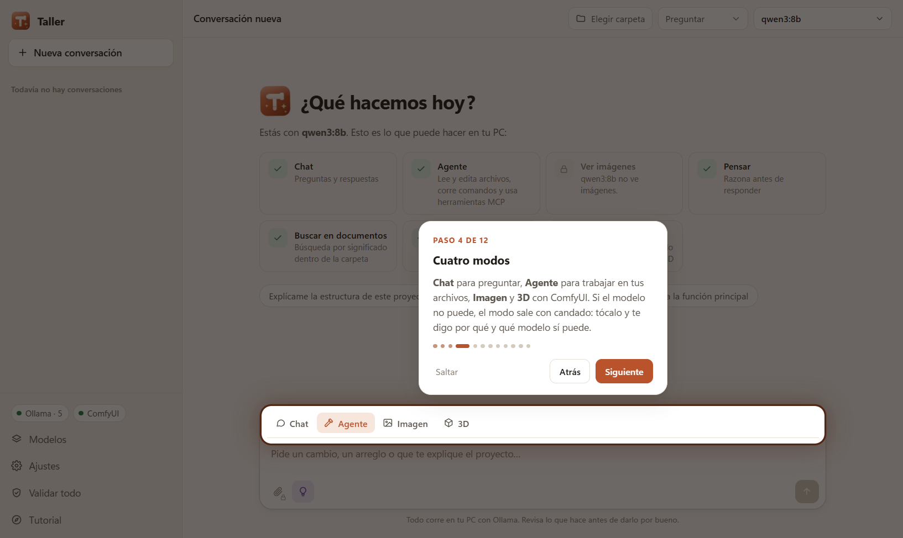
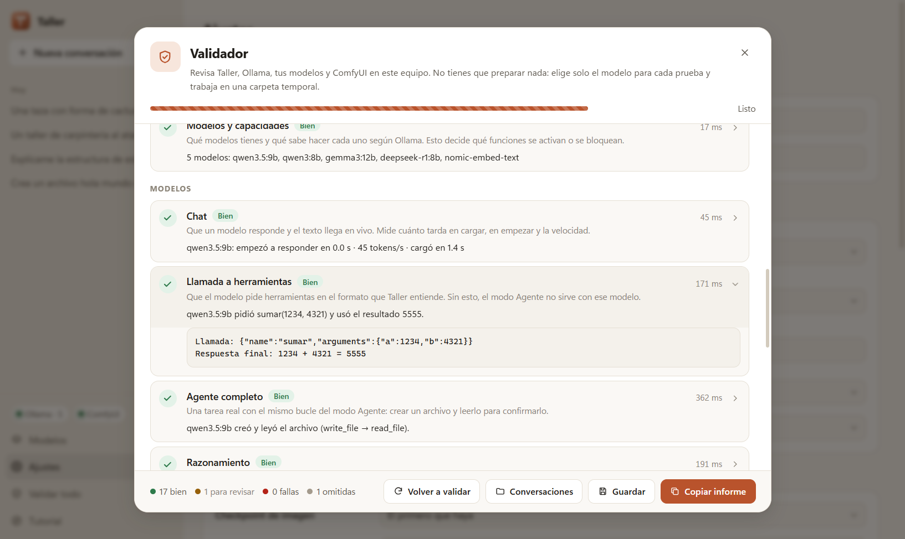
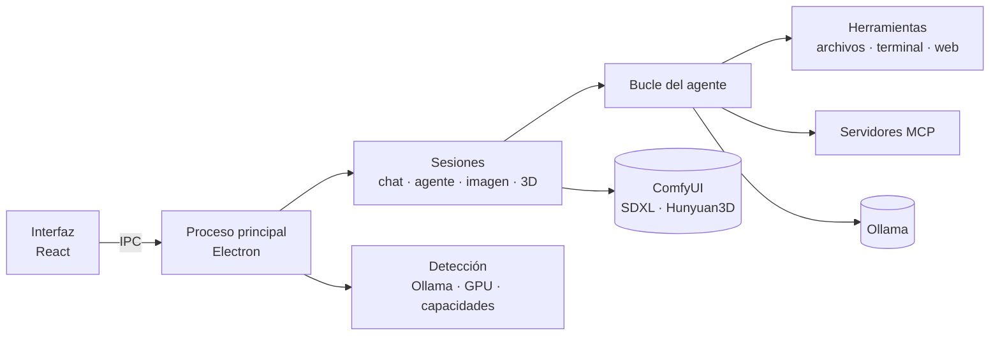

<p align="center">
  
</p>

<p align="center">
  <a href="https://github.com/RandyGrullon/Taller/releases/latest"></a>
  <a href="https://github.com/RandyGrullon/Taller/actions/workflows/pruebas.yml"></a>
  <a href="https://github.com/RandyGrullon/Taller/releases"></a>
  <a href="LICENSE"></a>
  
  
  
  
</p>

<p align="center">
  <b>Taller</b> es un agente de IA que corre en <b>tu</b> computadora: conversa, programa dentro de tus carpetas,<br>
  dibuja imágenes y crea modelos 3D con el modelo que tengas en Ollama. Nada sale a la nube.
</p>

<p align="center">
  <a href="https://github.com/RandyGrullon/Taller/releases/latest"></a>
</p>

<p align="center">
  <a href="#-características">Características</a> ·
  <a href="#-empezar">Empezar</a> ·
  <a href="#-tutorial-guiado">Tutorial</a> ·
  <a href="#-validador">Validador</a> ·
  <a href="#-el-agente">El agente</a> ·
  <a href="#-desarrollo">Desarrollo</a> ·
  <a href="#-preguntas-frecuentes">Preguntas</a>
</p>

<br>

<p align="center">
  
</p>

---

## ✨ Características

<table>
  <tr>
    <td width="50%" valign="top">
      <h3>🔒 Cada modelo dice qué sabe hacer</h3>
      Taller le pregunta a Ollama las capacidades de cada modelo. Lo que el modelo no puede hacer sale con candado; al tocarlo, explica por qué y te ofrece los modelos tuyos que sí pueden.
    </td>
    <td width="50%" valign="top">
      <h3>🛠️ Un agente de verdad</h3>
      Lee y edita archivos, busca en el código, corre comandos, lleva su lista de tareas y lanza subagentes. Antes de cambiar algo te enseña el diff y te pide permiso.
    </td>
  </tr>
  <tr>
    <td valign="top">
      <h3>🎨 Imágenes y 🧊 3D</h3>
      Con ComfyUI: texto a imagen (SDXL, Flux…) y foto o texto a modelo 3D con Hunyuan3D, con un visor que se puede girar.
    </td>
    <td valign="top">
      <h3>🔌 Servidores MCP</h3>
      Conecta herramientas externas con el mismo formato de <code>.mcp.json</code> que otros agentes; por ejemplo, <a href="https://github.com/morluto/rea">REA</a> para ingeniería inversa.
    </td>
  </tr>
  <tr>
    <td valign="top">
      <h3>🧭 Detecta todo solo</h3>
      Encuentra Ollama (o te ayuda a instalarlo y abrirlo), lista tus modelos, mira tu GPU y te recomienda qué descargar, con barra de progreso.
    </td>
    <td valign="top">
      <h3>🎓 Tutorial y animaciones</h3>
      Un recorrido guiado la primera vez y animaciones de carga, de generación y en toda la interfaz (respetan «reducir movimiento» del sistema).
    </td>
  </tr>
  <tr>
    <td colspan="2" valign="top">
      <h3>🛡️ Validador de un clic</h3>
      Un botón revisa Taller, Ollama, tus modelos y ComfyUI en tu equipo, sin preparar nada: elige solo el modelo para cada prueba, explica qué valida cada una y arma un informe para compartir.
    </td>
  </tr>
</table>

### Lo que activa cada modelo

| Función | Se activa si… | Ejemplo |
|---|---|---|
| 💬 **Chat** | el modelo genera texto | todos menos los de embeddings |
| 🛠️ **Agente** | el modelo usa **Herramientas** | `qwen3:8b`, `qwen3.5:9b` |
| 👁️ **Ver imágenes** | el modelo tiene **Visión** | `qwen3-vl:8b`, `gemma3:12b` |
| 💡 **Pensar** | el modelo **Razona** | `qwen3:8b`, `deepseek-r1:8b` |
| 📚 **Buscar en documentos** | hay un modelo de **Embeddings** instalado | `nomic-embed-text` |
| 🎨 **Imagen** · 🧊 **3D** | ComfyUI tiene el checkpoint y los nodos | SDXL · Hunyuan3D 2.1 |

<p align="center">
  
  
</p>

## 🚀 Empezar

### 1. Instala Ollama

Descárgalo de [ollama.com/download](https://ollama.com/download) y ábrelo. No hace falta bajar modelos todavía: Taller te recomienda los que le caben a tu equipo.

### 2. Instala Taller

**Opción A: instalador.** Baja `Taller-x.y.z-instalador.exe` de la [última versión](https://github.com/RandyGrullon/Taller/releases/latest) y ejecútalo.

> [!NOTE]
> El instalador todavía no está firmado. La primera vez, Windows SmartScreen avisa: elige **Más información → Ejecutar de todas formas**.

**Opción B: desde el código** (Node.js 20.19 o más nuevo):

```bash
git clone https://github.com/RandyGrullon/Taller.git
cd Taller
npm install
npm run dev
```

### 3. Abre Taller

Detecta Ollama en segundos (lo busca cada 5 s mientras no lo encuentra). Si está instalado pero apagado, tiene un botón para abrirlo. Si no tienes modelos, elige uno de los recomendados y se descarga ahí mismo.

<p align="center">
  
  
</p>

## 🎓 Tutorial guiado

La primera vez que abres Taller, un recorrido de un minuto ilumina cada parte de la ventana y explica para qué sirve: los motores, el selector de modelo, los modos, la carpeta, los permisos, el cuadro de texto, las conversaciones, los modelos y los ajustes. Se navega con los botones o con <kbd>←</kbd> <kbd>→</kbd>, y <kbd>Esc</kbd> lo cierra. Puedes repetirlo cuando quieras desde **Tutorial**, en la barra lateral, o desde **Ajustes**.

<p align="center">
  
  
</p>

## ✅ Validador

**Validar todo** (en la barra lateral, en **Modelos** y en **Ajustes**) abre una ventana que revisa todo de una vez. No tienes que preparar nada:

- Elige solo el modelo para cada prueba: el de tu conversación si sirve; si no, el más liviano que tenga lo necesario.
- Trabaja en una carpeta temporal, sin tocar tus proyectos.
- Si falta algo (Ollama, un modelo, ComfyUI), igual revisa lo demás y te dice qué falta y cómo resolverlo.
- Al terminar: **Copiar informe** (Markdown, listo para pegar), **Guardar** (en `Documentos\Taller`) y **Conversaciones** (abre la carpeta, por si hay que mandarla).

<p align="center">
  
</p>

| Grupo | Prueba | Qué valida |
|---|---|---|
| Taller | Versión y sistema | Qué versión de Taller corre y en qué sistema, CPU y RAM |
| Taller | Carpeta de datos | Que puede escribir y leer donde guarda ajustes y conversaciones |
| Taller | Herramientas de archivos | Que el agente crea, lee, edita, lista y busca archivos (en una carpeta temporal) |
| Taller | Terminal | Que el agente ejecuta comandos en PowerShell y que las tildes llegan bien |
| Taller | Visor de imágenes y 3D | Que la ventana muestra lo que se genera (protocolo interno `taller://`) |
| Taller | Tarjeta de video | Qué GPU NVIDIA tienes, su driver y su memoria |
| Taller | Internet | Que llegas a ollama.com para descargar (sin internet, lo demás funciona) |
| Ollama | Ollama corriendo | Que Ollama está instalado y responde; si no, dónde está o cómo bajarlo |
| Ollama | Modelos y capacidades | Qué modelos tienes y qué sabe hacer cada uno según Ollama |
| Modelos | Chat | Que un modelo responde en vivo; mide carga, primera palabra y tokens/s |
| Modelos | Llamada a herramientas | Que el modelo pide `sumar(1234, 4321)` en el formato correcto y usa el resultado |
| Modelos | Agente completo | Una tarea real con el bucle del Agente: crear un archivo y leerlo para confirmarlo |
| Modelos | Razonamiento | Que Pensar separa el razonamiento y la respuesta (17 × 23 = 391) sale bien |
| Modelos | Visión | Que el modelo ve imágenes: debe decir que un cuadro rojo es rojo |
| Modelos | Búsqueda por significado | Que dos frases parecidas quedan más cerca entre sí que de una distinta |
| Imágenes y 3D | ComfyUI | Que responde, qué GPU usa y si tiene checkpoint de imagen y Hunyuan3D |
| Imágenes y 3D | Generar una imagen | Una imagen real de 768×768; mide el tiempo |
| Imágenes y 3D | Generar un modelo 3D | Convierte esa imagen en 3D y revisa que el GLB sea válido |
| Extras | Servidores MCP | Que tus servidores MCP arrancan y dan herramientas |

Cada resultado es **Bien**, **Revisar** (funciona, pero con algo a mejorar), **Falla** u **Omitida** (con el motivo). Las pruebas con respuesta de un modelo se pueden abrir para ver exactamente qué contestó.

## 🧠 Modelos recomendados

| Modelo | Para qué | Capacidades | Tamaño |
|---|---|---|---:|
| `qwen3.5:9b` | Todo terreno | Herramientas · Visión · Razona | 6.6 GB |
| `qwen3:8b` | Agente de código liviano | Herramientas · Razona | 5.2 GB |
| `qwen3:14b` | Agente más capaz (12 GB de VRAM) | Herramientas · Razona | 9.3 GB |
| `qwen3-vl:8b` | Capturas y documentos | Herramientas · Visión · Razona | 6.1 GB |
| `qwen3-coder:30b` | El mejor para programar (GPU + RAM) | Herramientas | 19 GB |
| `gemma3:12b` | Conversa y ve imágenes | Visión | 8.1 GB |
| `llama3.2:3b` | PCs sin GPU | Herramientas | 2.0 GB |
| `nomic-embed-text` | Activa «Buscar en documentos» | Embeddings | 0.3 GB |

Cualquier otro de la [biblioteca de Ollama](https://ollama.com/library) se descarga desde la vista **Modelos**; sus capacidades se leen solas al terminar.

## 🤖 El agente

| Herramienta | Qué hace |
|---|---|
| `read_file` · `write_file` · `edit_file` | Lee con números de línea, escribe y reemplaza fragmentos exactos (únicos) |
| `list_files` · `grep` · `semantic_search` | Busca por nombre, por texto o por significado |
| `run_command` | Ejecuta comandos (PowerShell en Windows) y devuelve la salida y el código |
| `web_fetch` | Lee una página web |
| `todo_write` · `task` | Lleva la lista de tareas y lanza subagentes de solo lectura |
| `generate_image` · `generate_3d` | Usa ComfyUI desde la conversación |
| `mcp__*` | Las herramientas de tus servidores MCP |

| Permisos | Qué pregunta antes de hacer |
|---|---|
| **Preguntar** | Editar archivos, ejecutar comandos, entrar a la web o usar MCP |
| **Auto-editar** | Solo comandos, web y MCP; los archivos de la carpeta los edita solo |
| **Todo permitido** | Nada (úsalo en carpetas de prueba) |
| **Solo plan** | No cambia nada: mira y propone un plan |

<p align="center">
  
  
</p>

- **Memoria del proyecto:** si la carpeta tiene `TALLER.md` (o `AGENTS.md`, o `CLAUDE.md`), sus instrucciones entran al agente.
- **Contexto:** cuando la conversación llena el 80 % de la ventana, Taller la resume y sigue.
- **Modelos que escriben la llamada como texto:** Taller rescata `<tool_call>{…}</tool_call>` y bloques JSON, algo común en modelos locales.

### Servidores MCP

En **Ajustes → Servidores MCP** (también se puede importar el `.mcp.json` de la carpeta):

```json
{
  "rea": { "command": "npx", "args": ["-y", "rea-agents@6.7.0", "mcp"] }
}
```

## 🎨 Imágenes y 3D

Necesitas [ComfyUI](https://github.com/Comfy-Org/ComfyUI) corriendo (portable: puerto 8188; Desktop: 8000):

- **Imagen:** cualquier checkpoint de un archivo en `ComfyUI/models/checkpoints` (por ejemplo `sd_xl_base_1.0.safetensors`).
- **3D:** `hunyuan_3d_v2.1.safetensors` ([Hugging Face](https://huggingface.co/Comfy-Org/hunyuan3D_2.1_repackaged)), unos 10 GB de VRAM.

Si activas **Mejorar el prompt**, el modelo de chat reescribe tu idea en inglés y con detalle antes de dibujar.

<p align="center">
  
  
</p>

## ⌨️ Atajos

| Atajo | Acción |
|---|---|
| <kbd>Enter</kbd> | Enviar |
| <kbd>Shift</kbd> + <kbd>Enter</kbd> | Salto de línea |
| <kbd>Ctrl</kbd> + <kbd>N</kbd> | Conversación nueva |
| <kbd>Ctrl</kbd> + <kbd>V</kbd> | Pegar una imagen (con modelos de Visión, o en 3D) |
| <kbd>←</kbd> <kbd>→</kbd> · <kbd>Esc</kbd> | Moverse por el tutorial · cerrarlo |

## 💻 Desarrollo

| Comando | Qué hace |
|---|---|
| `npm run dev` | Abre Taller con recarga en caliente |
| `npm run simular` | Levanta Ollama y ComfyUI **simulados** (para PCs sin GPU) |
| `npm test` | Pruebas con Vitest |
| `npm run typecheck` | Revisa los tipos |
| `npm run capturas` | Recorre la app con Playwright y regenera `capturas/` |
| `npm run dist` | Arma el instalador de Windows en `release/` |

`npm run simular -- --vacio` arranca un Ollama sin modelos para ver la bienvenida.

### Arquitectura



```
src/
  main/         proceso principal: Ollama, ComfyUI, MCP, sesiones y detección
    agente/     bucle, herramientas, permisos, prompt de sistema y compactación
  preload/      puente seguro (window.taller)
  renderer/     la interfaz, el tutorial y las animaciones
  shared/       tipos, la matriz de funciones por modelo y el catálogo
scripts/        simuladores, capturas y SVG → PNG
tests/          pruebas con Vitest
```

El comportamiento del agente (herramientas, permisos, subagentes, MCP, compactación, archivo de memoria) sigue la documentación pública de Claude Code y agentes abiertos como [Qwen Code](https://github.com/QwenLM/qwen-code) y [OpenCode](https://github.com/sst/opencode). No usa código de Claude Code.

## 🗺️ Hoja de ruta

- [x] Detección de Ollama, GPU y capacidades por modelo
- [x] Agente con permisos, subagentes, MCP y compactación
- [x] Imagen y 3D con ComfyUI
- [x] Tutorial guiado y animaciones
- [x] Validador de un clic con informe
- [ ] Probar con Ollama y ComfyUI reales en GPU
- [ ] Instalador firmado y actualizaciones automáticas
- [ ] Probar en macOS y Linux
- [ ] Texturas en los modelos 3D

## ❓ Preguntas frecuentes

<details>
<summary><b>¿Cómo sé si todo funciona en mi PC?</b></summary>
<br>
Toca <b>Validar todo</b>. En unos minutos revisa la app, Ollama, cada capacidad de tus modelos y ComfyUI, y te deja un informe para copiar.
</details>

<details>
<summary><b>¿Necesito internet?</b></summary>
<br>
Solo para descargar Ollama y los modelos. Después, todo corre en tu PC. El agente sale a la web únicamente si usas <code>web_fetch</code>, y te pide permiso.
</details>

<details>
<summary><b>¿Por qué el modo Agente sale con candado?</b></summary>
<br>
Porque el modelo elegido no sabe usar herramientas. Toca el candado: Taller te dice qué modelos tuyos sí pueden, o cuál descargar.
</details>

<details>
<summary><b>¿Rinde como un modelo grande en la nube?</b></summary>
<br>
No. Un modelo local de 8–14B va bien para tareas acotadas (explicar código, cambios puntuales, scripts). Para trabajos largos, usa el modelo más grande que le quepa a tu GPU.
</details>

<details>
<summary><b>¿Ollama corre en otra máquina?</b></summary>
<br>
Cambia la dirección en <b>Ajustes → Conexiones</b> (por ejemplo <code>http://192.168.1.20:11434</code>).
</details>

<details>
<summary><b>¿Dónde se guardan mis conversaciones?</b></summary>
<br>
En la carpeta de datos de la app (<code>%APPDATA%\Taller</code> en Windows), en JSON. Las imágenes y modelos 3D generados van a <code>taller-salidas</code> dentro de la carpeta de trabajo.
</details>

## ⚠️ Estado

- Todo se probó con los simuladores de Ollama y ComfyUI; falta una pasada con los reales en una GPU. El **Validador** sirve justo para eso.
- Probado en Windows 11. macOS y Linux deberían funcionar, pero no se han probado.

## 📄 Licencia

[MIT](LICENSE) © 2026 Randy Grullón

<p align="center">
  <br>
  <sub>Hecho en República Dominicana con martillo, chispas y modelos locales.</sub>
</p>
